# Multipurpose Modular Art Supplies & Desk Organizer
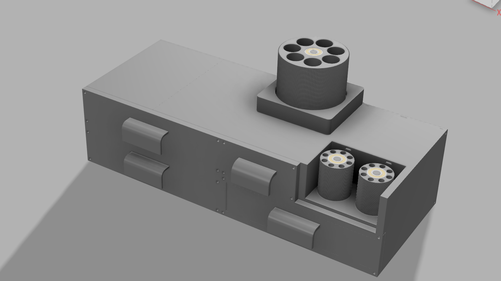
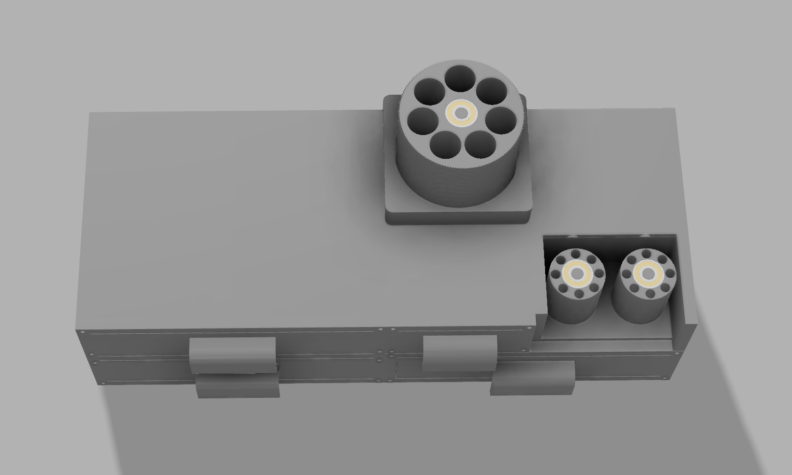
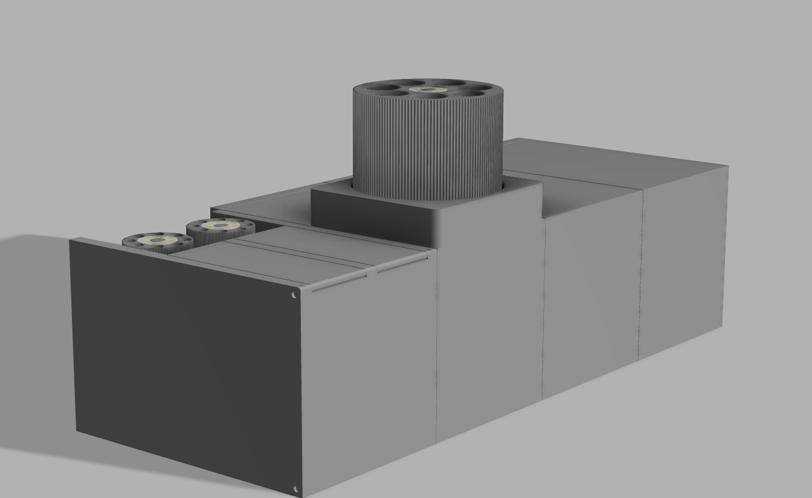
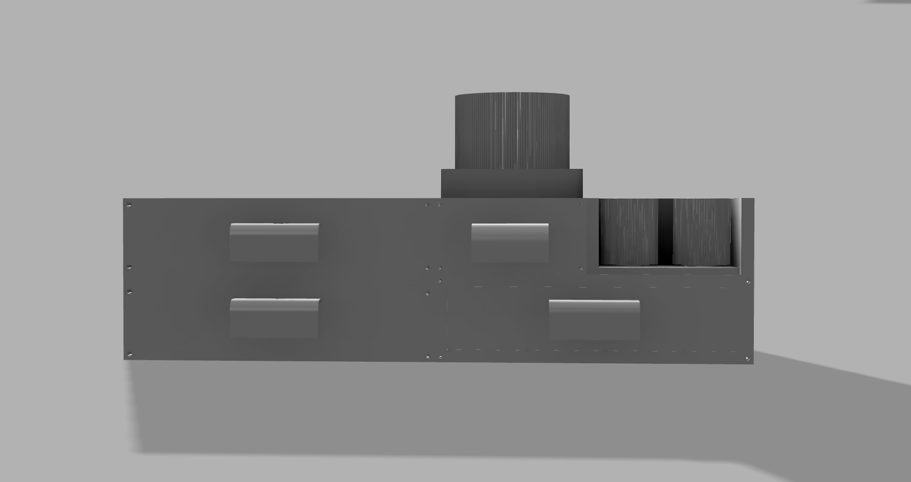

This is a desk organizer for my art supplies and stationery. It’s two boxes that snap together with magnets.

##  Collaboration & Attribution (Team Project)

This project was built in collaboration with my friend **Mr. Chronos** (https://github.com/Chronos-03/MultiPurposeorganiser).as I was learning several things from scratch, we worked together over meet sessions. our files look very similar beause they were made side by side in real time. I created my own project files step-by-step alongside him.

The design is split into two sections:

1. Main Compartment (MAINBOX):
   * Drawers: Two sliding drawers, one smaller drawer on top-left and a larger one running across the bottom.
   * Rotating Tool & Stationery Holders: The top has one large rotating cylinder with 8 holes for screwdrivers, along with two smaller rotating cylinders for pens, pencils, brushes and other stationery.
   * Hinged Storage Compartments: Two small compartments with hinged lids on the top right.
2. Secondary Compartment (BOX2):
   * This box has two vertical drawers of the same size. I divided the inside of both drawers into smaller grid sections so I can keep the colours sorted instead of mixing everything together.

## Hardware Required

* Super Glue (Cyanoacrylate adhesive) Used for joining the separately printed parts, fixing the magnets, and securing the hinge locks.
* Neodymium Magnets (4mm × 2mm) to attach the rotating holders and connect the two boxes.
* M3 Brass Heat-Set Inserts Fitted into the front faces of both boxes.
* M3 Screws for attaching the front covers.
* 6000ZZ bearings, for the rotating cylinders.

## Assembly Instructions

### Part 1: Assembling the Main Compartment (MAINBOX)

#### 1. Joining the Main Body Halves
The main compartment is split into two halves for easier printing: MAINBOX(left) and MAINBOX(right) to make printing easier.
* Locate the alignment pins (pop-out rods) on one half and the matching alignment holes on the other half.
* Glue the halves together using the pins and holes, then press MAINBOX(left) and MAINBOX(right) firmly together until fully seated.

#### 2. Install Side Magnets and Front Heat-Set Inserts
* Side Magnets: There are 4 holes in the corners of both the left and right outer walls. Glue 4mm × 2mm neodymium magnets into these holes.BOX2 attaches to these.
* Heat-Set Inserts: Heat-set the M3 inserts into the holes on the front. *(Note: Do not screw on the front covers yet—the drawers must be inserted first.)*

#### 3. Assemble and Insert the Drawers
The main compartment has two drawers: a smaller one at the top and a larger one at the bottom. Both have 5mm square rails on the sides that slide into matching grooves inside the box.

* Top Small Drawer: Print MAINBOXSMALLDRAWER and slide it directly into the top-left grooves.
* Bottom Large Drawer: Print MAINBOXBIGDRAWER(left) and MAINBOXBIGDRAWER(right).
* Glue the left and right halves together using the alignment pins and holes, just like you did for the main body.

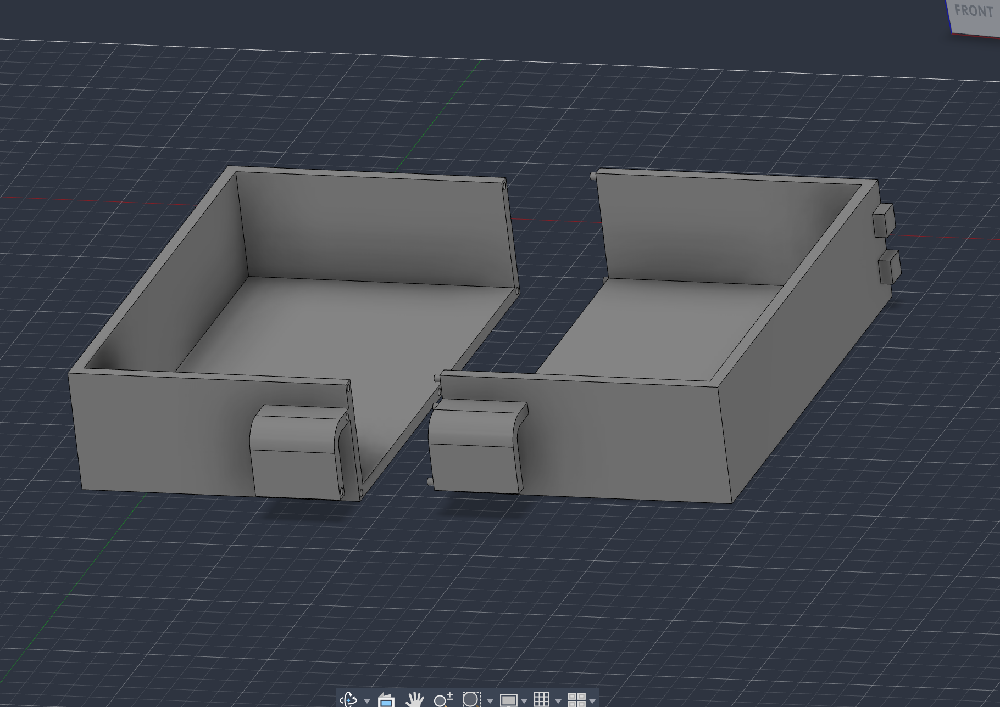

* Once the glue dries, slide the assembled large drawer into the bottom grooves of the main compartment.

#### 4. Attach the Front Covers
* Print MAINBOXCOVER(bottom) and MAINBOXCOVER(top).
* Screw the covers onto the inserts. This holds the drawers in.

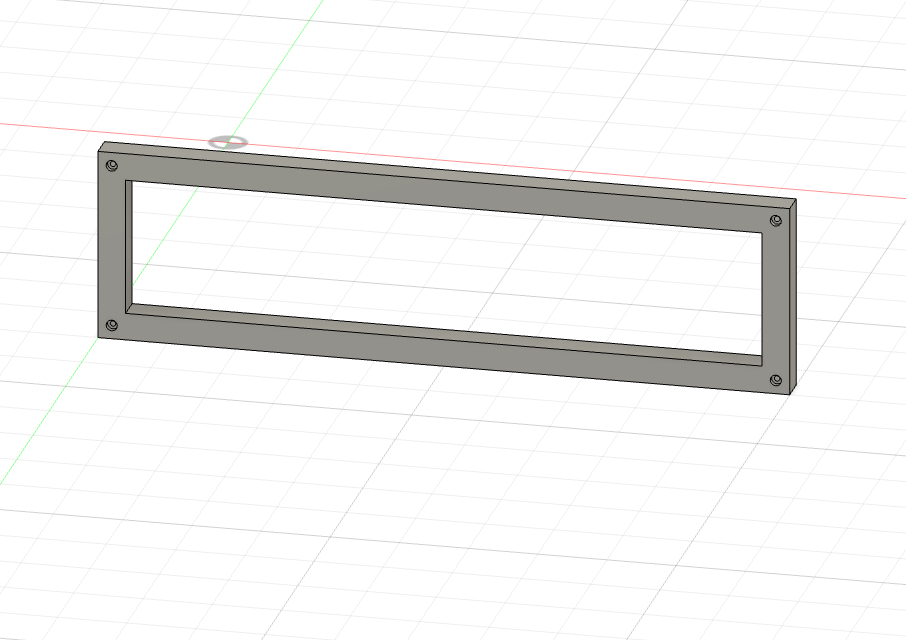

#### 5. Assemble the Rotating Screwdriver & Stationery Holders
The top of the main compartment has two rotating organizer units: one with a large cylinder and another with two smaller cylinders.

* Print the following files:
  * ROTATINGTOP(big) (base with 1 central rod)
  * ROTATINGTOP(small) (base with 2 rods)
  * ROTATINGBODY(big) (1 large cylindrical holder)
  * ROTATINGBODY(small) (2 small cylindrical holders)
* Fit the 6000ZZ ball bearings into the top and bottom recesses of each cylindrical body. Once fitted, place the cylinders onto their respective rods on the base plates.
* Turn both base plates upside down. You'll find magnet slots underneath the big and small rotating bases. Apply a little super glue and fit the 4mm × 2mm magnets into these holes.

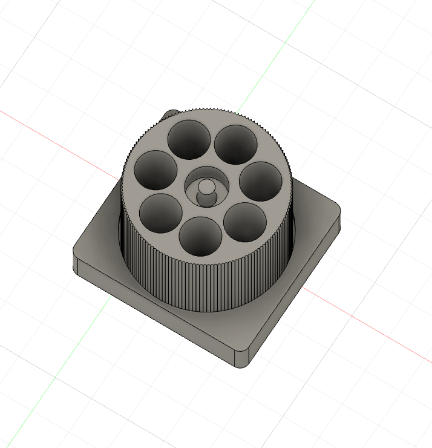

Next, glue matching 4mm × 2mm magnets into the top surface of the main compartment. Make sure the polarities are correct so that the magnets attract each other. Once the glue dries, place the rotating holders on top as shown below.

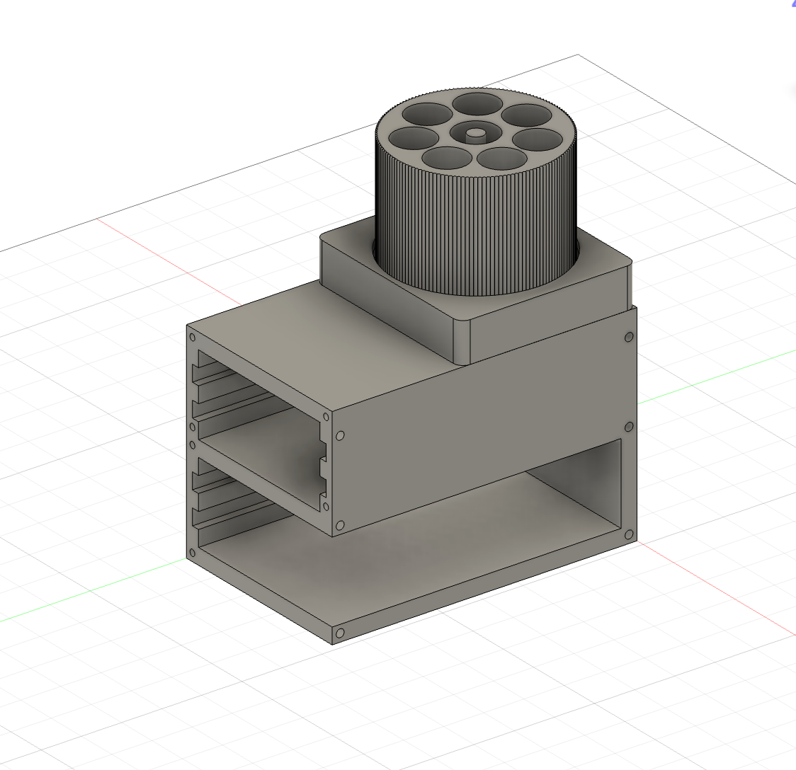

#### 6. Assemble the Hinged Lid Compartments
The right side of the main compartment has two top-facing storage sections with flip-up lids.

> IMPORTANT PRINT NOTE: You must print MAINBOXHINGECOVER 2 times (one for each compartment lid).

* Print the hinge locks: HINGELOCK(left), HINGELOCK(middle), and HINGELOCK(right).
* Place both MAINBOXHINGECOVER lids into position on the top-right compartments, aligning their hinge cutouts.
* Insert HINGELOCK(left) on the left side, HINGELOCK(middle) in the center between the two lids, and HINGELOCK(right) on the right side.
* Secure the hinge locks to the main body using a small amount of super glue.

> CAUTION: Don’t get glue on the lid pins or the hinges will stick.

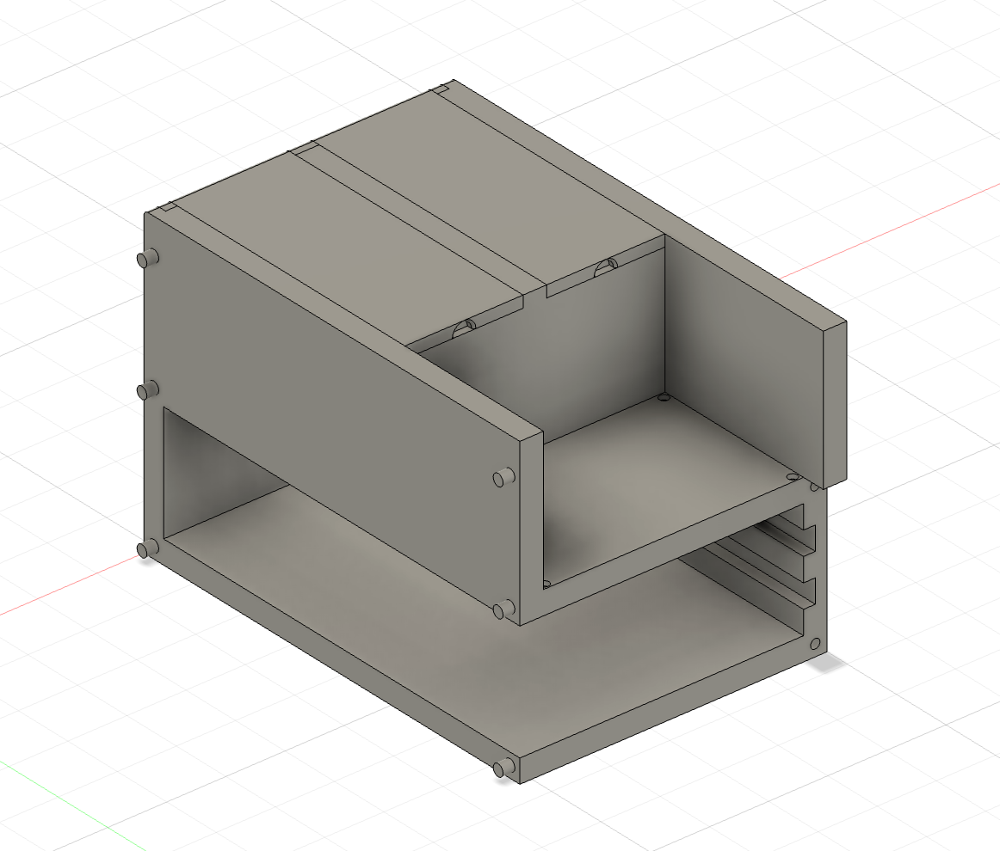
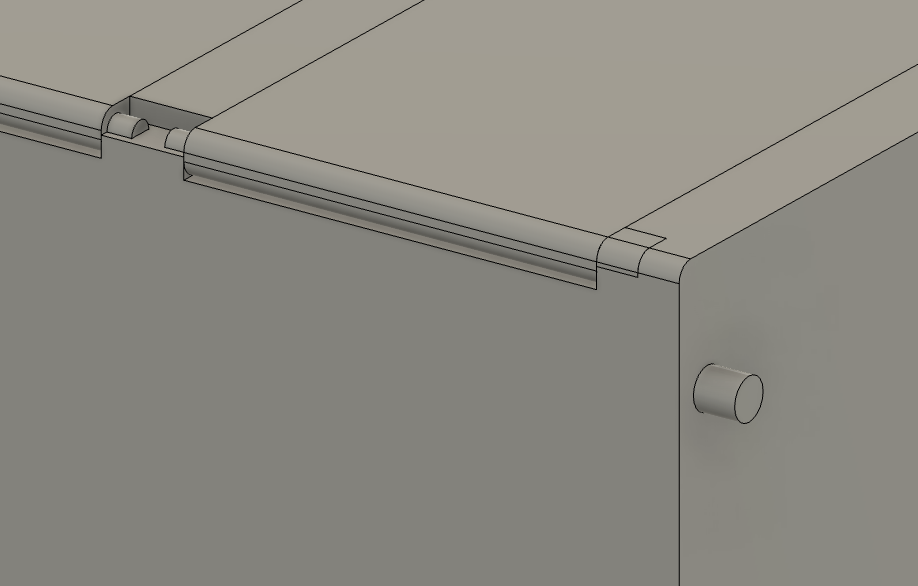
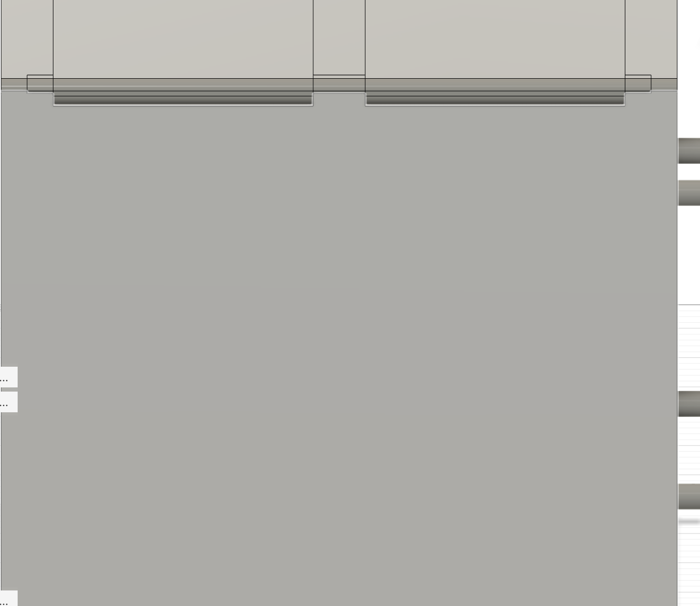

### Part 2: Assembling the Secondary Compartment (BOX2)

#### 1. Join the Box 2 Body Halves
* Print BOX2(left) and BOX2(right).
* Apply super glue to the alignment pins and matching holes, then press both halves together until they fit properly, just like the main compartment.

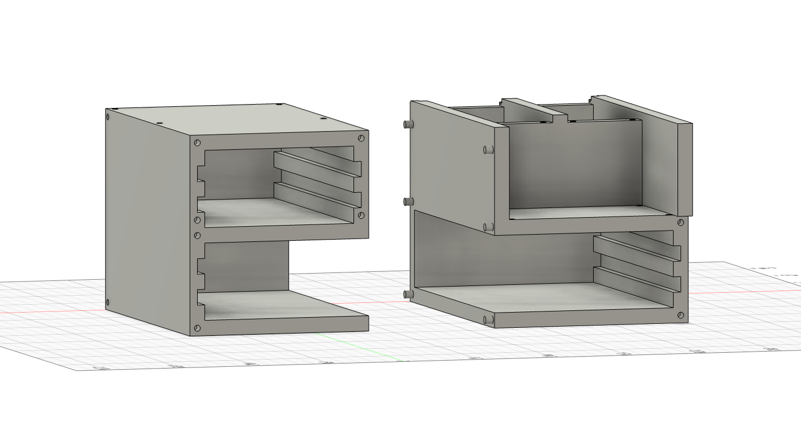

#### 2. Assemble the Divided Component Drawers
BOX2 has two identical vertical drawers, each divided into smaller grid sections for storing screws, nuts, and other small components. Both drawers are printed in two separate halves.

> IMPORTANT PRINT NOTE: You must print BOTH BOX2DRAWER(left) and BOX2DRAWER(right) 2 times (4 pieces total to make 2 complete drawers).

* Join each BOX2DRAWER(left) with a BOX2DRAWER(right) using super glue and the alignment pins, just like you did with the large drawer in the main compartment.
* slide both completed drawers into their respective vertical slots inside BOX2.

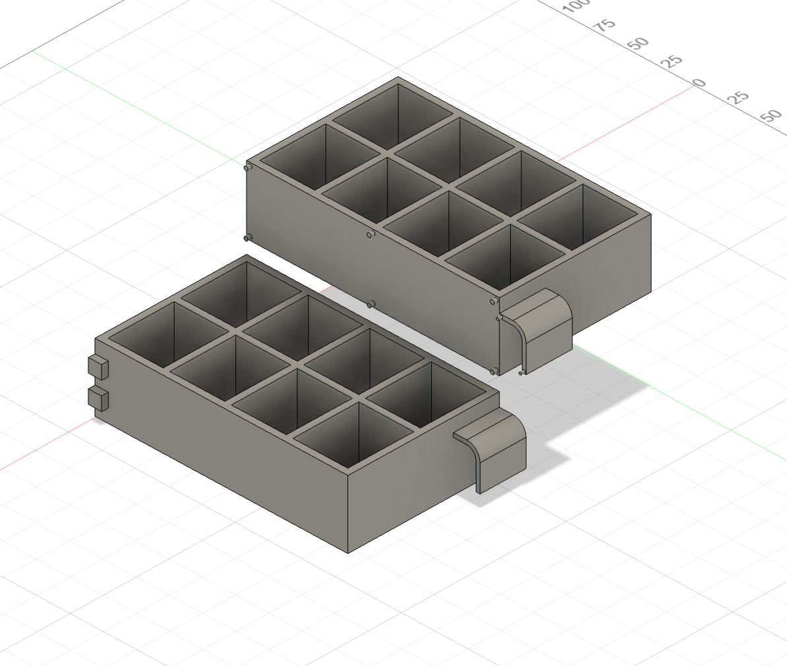

#### 3. Install Magnets, Heat-Set Inserts, and the Front Cover
* Apply super glue and fit the 4mm × 2mm neodymium magnets into the corner holes on both outer side walls of BOX2. Check the polarity beforehand so that the magnets attract those on MAINBOX.
* Use a soldering iron to fit the M3 brass heat-set inserts into the mounting holes on the front face ofBOX2.
* Print BOX2COVER, align it over the front of BOX2, and secure it tightly using M3 screws.

## Bill of Materials (BOM)

| Part | Description | Qty | Unit Price | Total | Vendor | Link |
| :--- | :--- | :---: | :---: | :---: | :--- | :--- |
| **[6000 ZZ Bearing](https://onlyscrews.in/products/6000-zz-deep-groove-ball-bearing-10x26x8)** | Smooth rotation | 6 | $0.19 | $1.14 | Onlyscrews | [Buy Here](https://onlyscrews.in/products/6000-zz-deep-groove-ball-bearing-10x26x8) |
| **[Magnet (4mm × 2mm)](https://onlyscrews.in/products/4mm-diameter-neodymium-disc-magnets-n35?variant=51058762219833)** | Interconnection | 40 | $0.07 | $2.80 | Onlyscrews | [Buy Here](https://onlyscrews.in/products/4mm-diameter-neodymium-disc-magnets-n35?variant=51058762219833) |
| **[M3 Brass Heatset](https://onlyscrews.in/products/m3-x-4mm-3d-printing-brass-threaded-inserts-dia-3mm-length-4mm)** | For the screw thread | 20 | $0.05 | $1.00 | Onlyscrews | [Buy Here](https://onlyscrews.in/products/m3-x-4mm-3d-printing-brass-threaded-inserts-dia-3mm-length-4mm) |
| **[M3 Screw Set](https://onlyscrews.in/products/m3-phillips-countersunk-ss304-assorted-box)** | For attaching parts | 1 | $2.21 | $2.21 | Onlyscrews | [Buy Here](https://onlyscrews.in/products/m3-phillips-countersunk-ss304-assorted-box) |
| **[Super Glue](https://onlyscrews.in/products/kwality-777-non-whitening-extremely-strong-bonding-adhesive-20g)** | Attaching the split parts | 2 | $0.47 | $0.94 | Onlyscrews | [Buy Here](https://onlyscrews.in/products/kwality-777-non-whitening-extremely-strong-bonding-adhesive-20g) |
| **[main body](https://printlegion.hackclub.com/)** | printing | 1 | $24 | $24 | printlegion.hackclub | [Buy Here](https://printlegion.hackclub.com/) |

| **Total** | | | | **$32.09** | | |
