# Multipurpose Modular Art Supplies & Desk Organizer
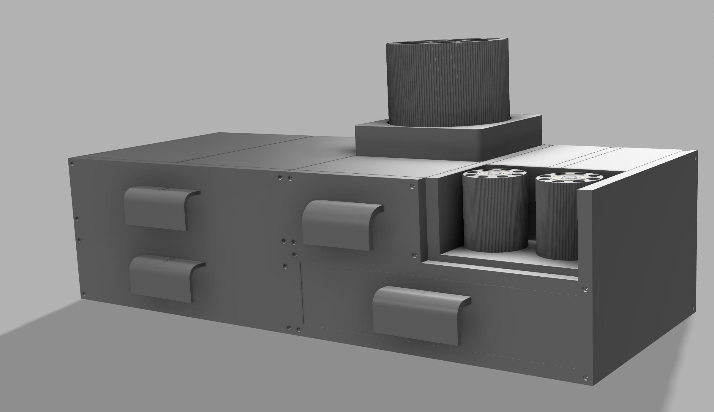
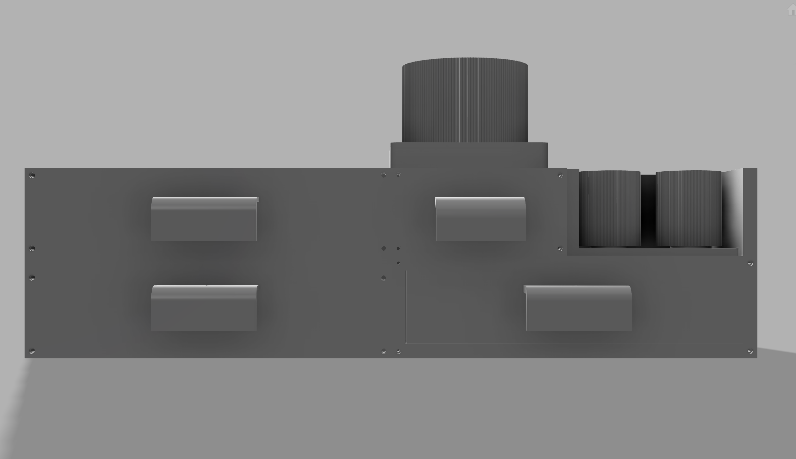
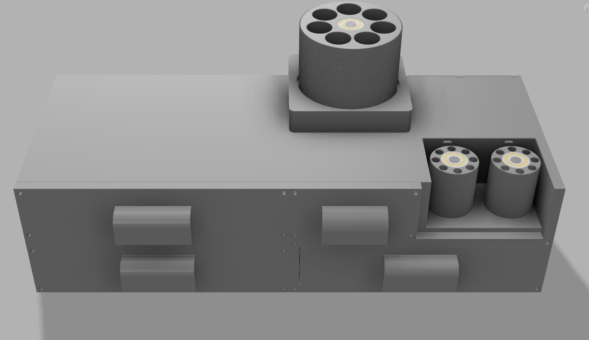
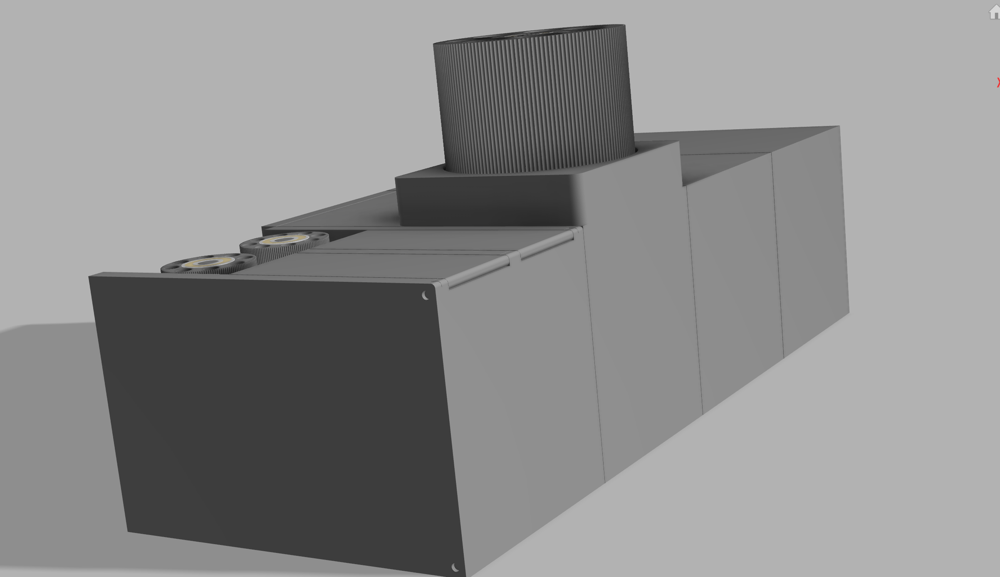

This is a custom multipurpose desk organizer I designed to keep all of my art supplies, drawing tools, and stationery neatly organized in one modular setup.

The organizer is divided into two main magnetic modules:

1. **Main Compartment (`MAINBOX`):**
   * **Drawers:** Features two sliding drawers—one small drawer on the top-left and one large, full-width drawer on the bottom.
   * **Rotating Tool & Stationery Holders:** Mounted on the top surface. Includes one large rotating cylinder (with 8 holes) for screwdrivers, and a dual-cylinder rotating unit (two small cylinders with 8 holes each) for stationery like pens and pencils.
   * **Hinged Storage Compartments:** Located on the top-right section, featuring two compartments with flip-up rotating lids.
2. **Secondary Compartment (`BOX2`):**
   * Features two equal-sized vertical drawers. Each drawer is divided into small grid compartments designed to store screws, nuts, and mini electronic components.

## Hardware Required

* **Super Glue** (Cyanoacrylate adhesive for joining split printed parts and securing magnets/hinge locks)
* **Neodymium Magnets (4mm × 2mm)** (For attaching the rotating modules and magnetically connecting future compartments)
* **M3 Brass Heat-Set Inserts** (Installed into the front faces of the boxes)
* **M3 Screws** (For securing the front drawer covers)
* **6000ZZ Ball Bearings** (For the top and bottom of the rotating cylinders)

---

## Assembly Instructions

### Part 1: Assembling the Main Compartment (`MAINBOX`)

#### 1. Join the Main Body Halves
The main compartment is split into two halves for easier printing: `MAINBOX(left)` and `MAINBOX(right)`. 
* Locate the alignment pins (pop-out rods) on one half and the matching alignment holes on the other half.
* Apply super glue to the interlocking surfaces and alignment pins, then press `MAINBOX(left)` and `MAINBOX(right)` firmly together until fully seated.

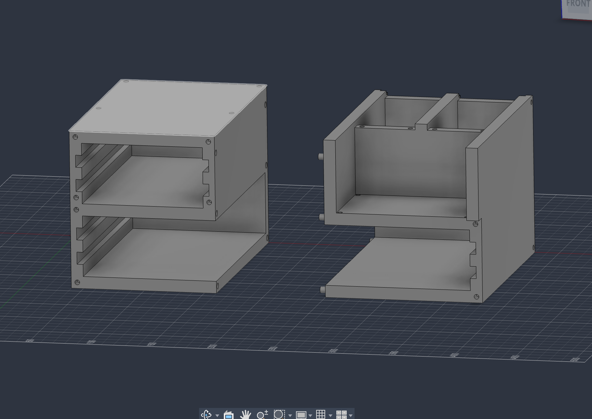

#### 2. Install Side Magnets and Front Heat-Set Inserts
* **Side Magnets:** There are 4 holes in the corners of both the left and right outer walls. Glue **4mm × 2mm neodymium magnets** into these holes. These allow you to magnetically attach `BOX2` or future modular expansions.
* **Heat-Set Inserts:** Locate the mounting holes on the front face of the combined main compartment and melt in your **M3 brass heat-set inserts** using a soldering iron. *(Note: Do not screw on the front covers yet—the drawers must be inserted first.)*

#### 3. Assemble and Insert the Drawers
The main compartment houses two drawers (a small top drawer and a large bottom drawer). Each drawer features 5mm square side rails that slide into the matching internal grooves of the box.

* **Top Small Drawer:** Print `MAINBOXSMALLDRAWER` and slide it directly into the top-left grooves.
* **Bottom Large Drawer:** Print `MAINBOXBIGDRAWER(left)` and `MAINBOXBIGDRAWER(right)`. Glue the left and right halves together using the alignment pins and holes, just like you did for the main body.

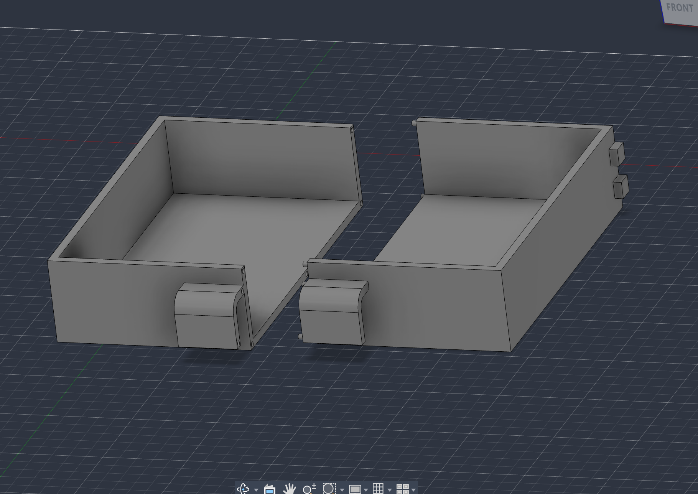

* Once the glue dries, slide the assembled large drawer into the bottom grooves of the main compartment.

#### 4. Attach the Front Covers
* Print `MAINBOXCOVER(bottom)` and `MAINBOXCOVER(top)`.
* Align the covers over the front of the main compartment and tighten them into the M3 brass heat-set inserts using **M3 screws** to secure the drawers in place.

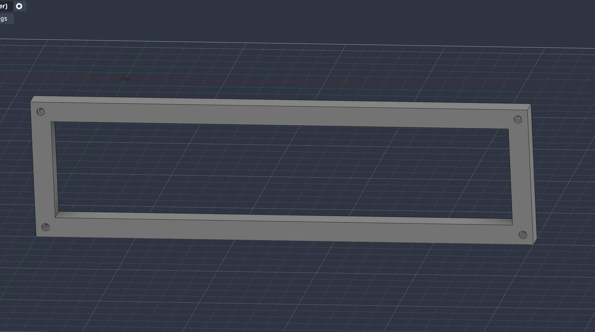

#### 5. Assemble the Rotating Screwdriver & Stationery Holders
The top of the main compartment supports two rotating organizer units (one large single cylinder and one dual small cylinder unit).

* Print the following files:
  * `ROTATINGTOP(big)` (base with 1 central rod)
  * `ROTATINGTOP(small)` (base with 2 rods)
  * `ROTATINGBODY(big)` (1 large cylindrical holder)
  * `ROTATINGBODY(small)` (2 small cylindrical holders)
* Insert **6000ZZ ball bearings** into the top and bottom recesses of the cylindrical bodies, and press them onto their respective rods on the base plates.
* Flip the bases over—you will find magnet holes on the underside of both the big and small rotating bases. Glue **4mm × 2mm magnets** into these bottom holes.

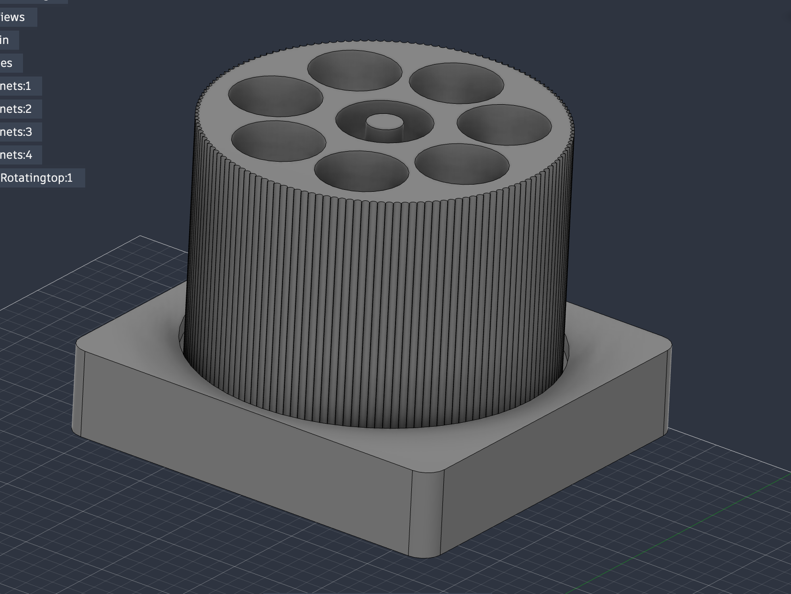

* Next, glue matching **4mm × 2mm magnets** into the top surface of the main compartment (making sure the magnet polarities attract) and place the rotating holders on top as shown below.

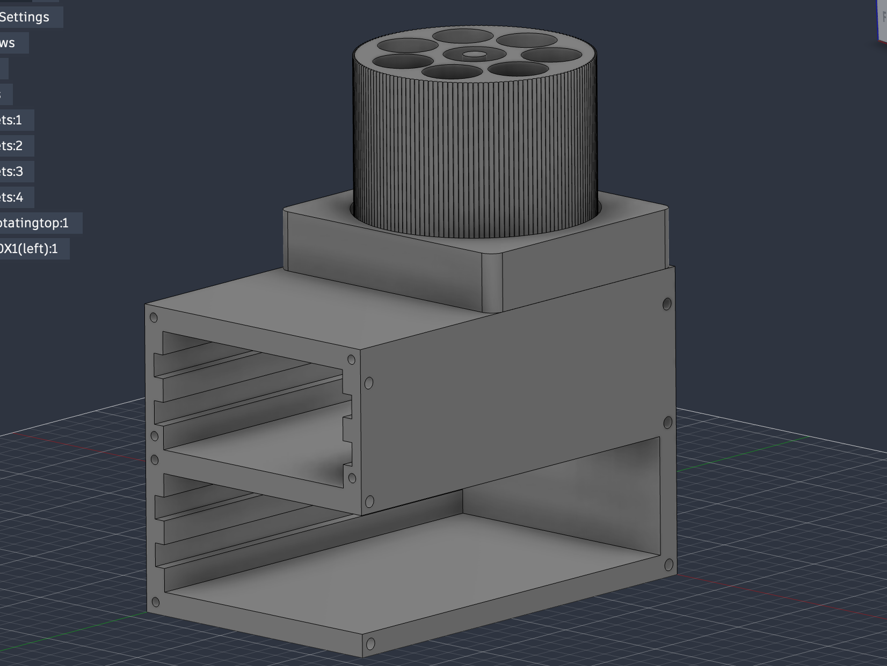

#### 6. Assemble the Hinged Lid Compartments
The right side of the main compartment has two top-facing storage sections with flip-up lids.

> ⚠️ **IMPORTANT PRINT NOTE:** You must print **`MAINBOXHINGECOVER` 2 times** (one for each compartment lid).

* Print the hinge locks: `HINGELOCK(left)`, `HINGELOCK(middle)`, and `HINGELOCK(right)`.
* Place both `MAINBOXHINGECOVER` lids into position on the top-right compartments, aligning their hinge cutouts.
* Insert `HINGELOCK(left)` on the left side, `HINGELOCK(middle)` in the center between the two lids, and `HINGELOCK(right)` on the right side.
* Secure the hinge locks to the main body using a small amount of super glue.

> ⚠️ **CAUTION:** Apply glue carefully to the outer lock seats only. **Make sure no glue gets onto the lid pins so the hinges can rotate freely!**

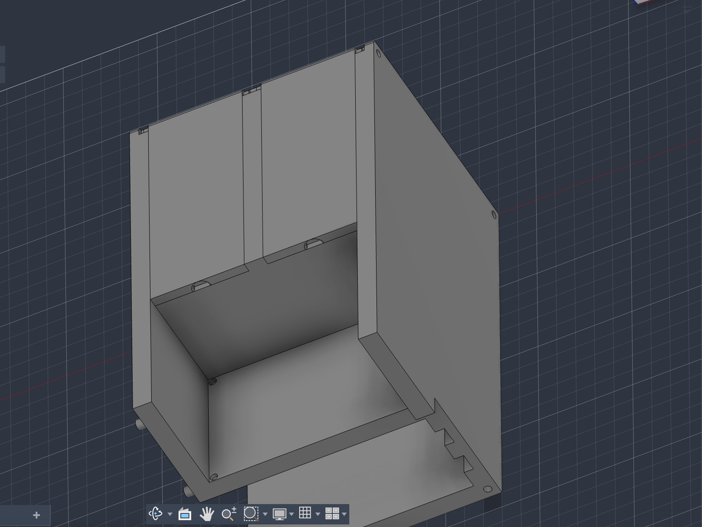
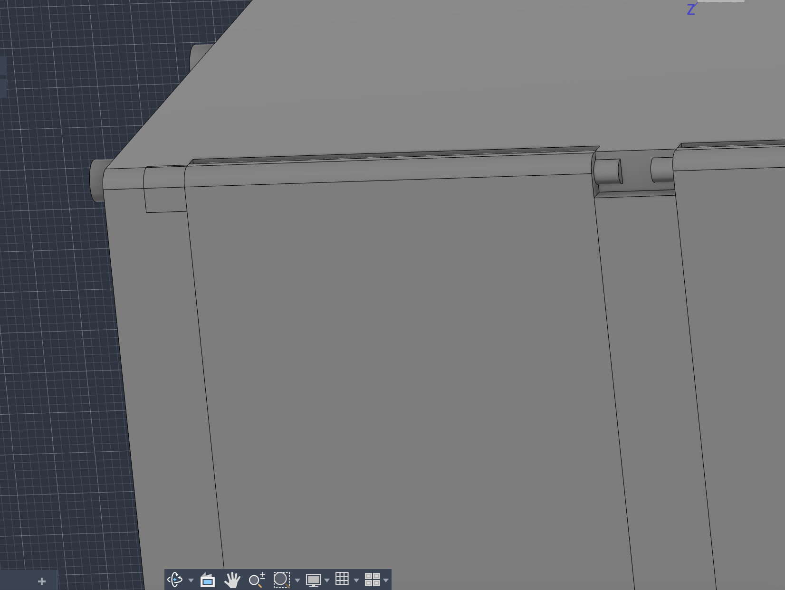
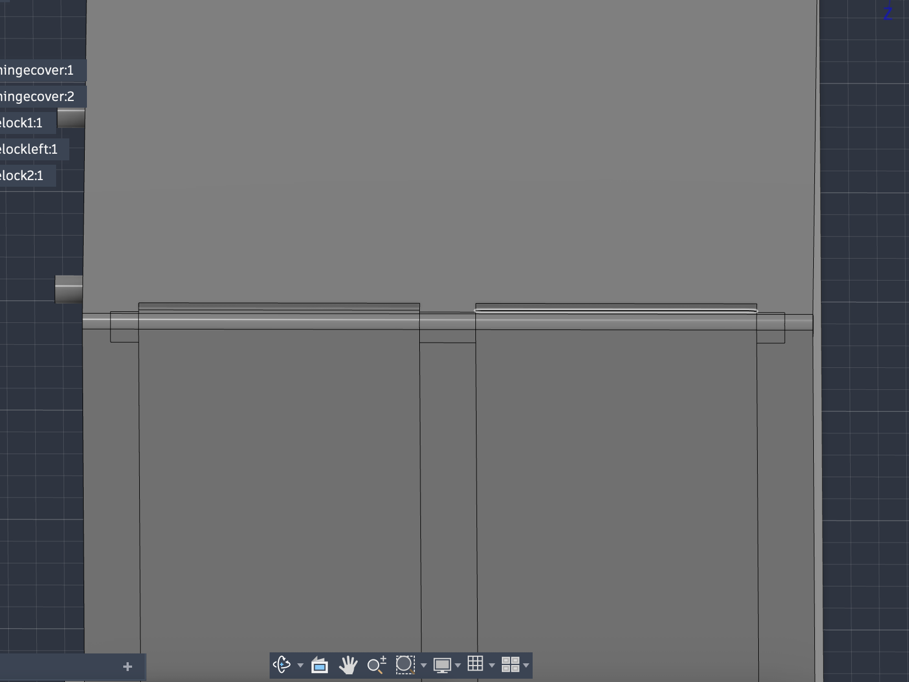

### Part 2: Assembling the Secondary Compartment (`BOX2`)

#### 1. Join the Box 2 Body Halves
* Print `BOX2(left)` and `BOX2(right)`.
* Apply super glue to the interlocking alignment pins and holes, and press both halves together just like the main compartment.

<!-- /// images -->
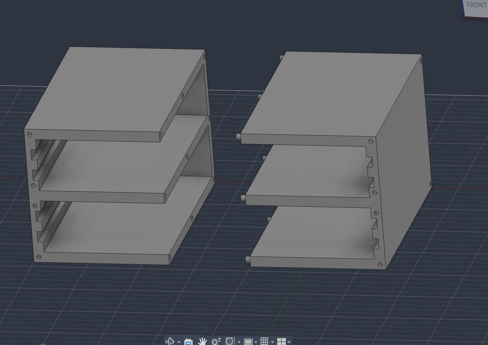

#### 2. Assemble the Divided Component Drawers
`BOX2` holds two identical vertical multi-grid drawers, and each drawer is printed in two halves.

> ⚠️ **IMPORTANT PRINT NOTE:** You must print BOTH **`BOX2DRAWER(left)` and `BOX2DRAWER(right)` 2 times** (4 pieces total to make 2 complete drawers).

* Glue each pair of `BOX2DRAWER(left)` and `BOX2DRAWER(right)` together using the alignment pins, following the exact same method used for the large drawer in the main compartment.
* Slide both completed drawers into the vertical slots of `BOX2`.

<!-- /// images -->
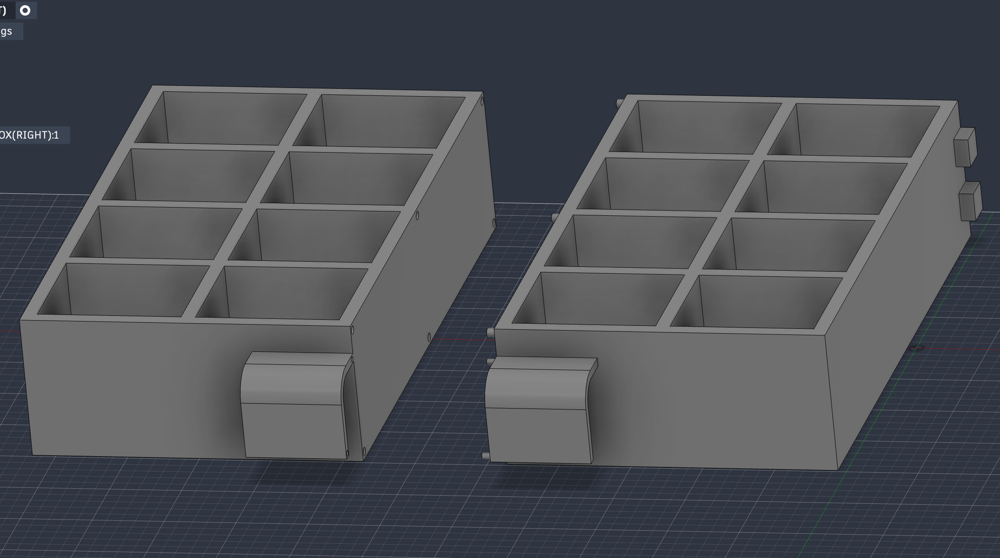

#### 3. Install Magnets, Heat-Set Inserts, and the Front Cover
* Glue **4mm × 2mm neodymium magnets** into the corner holes on the left and right outer walls of `BOX2` (check polarity so it snaps onto `MAINBOX`).
* Melt **M3 brass heat-set inserts** into the mounting holes on the front face of `BOX2`.
* Print `BOX2COVER`, align it over the front of `BOX2`, and secure it tightly using **M3 screws**.

## Bill of Materials (BOM)

| Part | Description | Qty | Unit Price | Total | Vendor | Link |
| :--- | :--- | :---: | :---: | :---: | :--- | :--- |
| **[6000 ZZ Bearing](https://onlyscrews.in/products/6000-zz-deep-groove-ball-bearing-10x26x8)** | Smooth rotation | 6 | $0.19 | $1.14 | Onlyscrews | [Buy Here](https://onlyscrews.in/products/6000-zz-deep-groove-ball-bearing-10x26x8) |
| **[Magnet (4mm × 2mm)](https://onlyscrews.in/products/4mm-diameter-neodymium-disc-magnets-n35?variant=51058762219833)** | Interconnection | 40 | $0.07 | $2.80 | Onlyscrews | [Buy Here](https://onlyscrews.in/products/4mm-diameter-neodymium-disc-magnets-n35?variant=51058762219833) |
| **[M3 Brass Heatset](https://onlyscrews.in/products/m3-x-4mm-3d-printing-brass-threaded-inserts-dia-3mm-length-4mm)** | For the screw thread | 20 | $0.05 | $1.00 | Onlyscrews | [Buy Here](https://onlyscrews.in/products/m3-x-4mm-3d-printing-brass-threaded-inserts-dia-3mm-length-4mm) |
| **[M3 Screw Set](https://onlyscrews.in/products/m3-phillips-countersunk-ss304-assorted-box)** | For attaching parts | 1 | $2.21 | $2.21 | Onlyscrews | [Buy Here](https://onlyscrews.in/products/m3-phillips-countersunk-ss304-assorted-box) |
| **[Super Glue](https://onlyscrews.in/products/kwality-777-non-whitening-extremely-strong-bonding-adhesive-20g)** | Attaching the split parts | 2 | $0.47 | $0.94 | Onlyscrews | [Buy Here](https://onlyscrews.in/products/kwality-777-non-whitening-extremely-strong-bonding-adhesive-20g) |
| **Total** | | | | **$8.09** | | |

*Note: This README was written by me, with only basic grammar, spelling, and formatting improvements done by AI.*